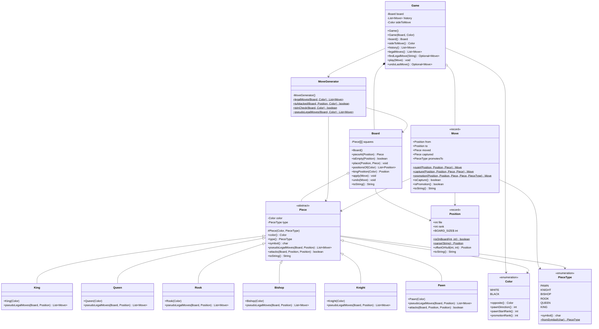
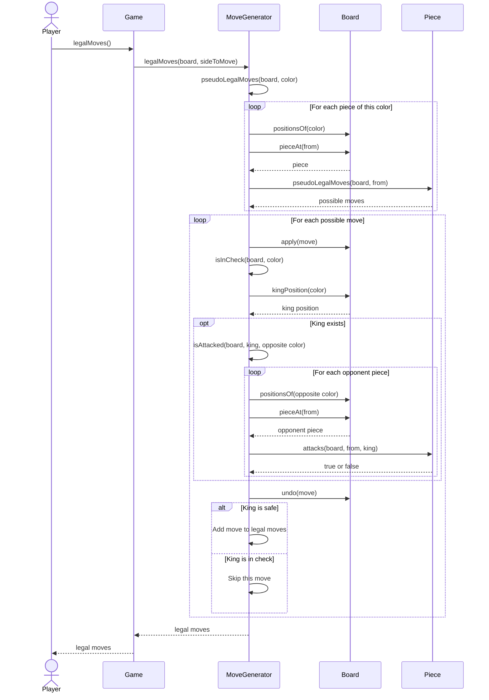

# Milestone 5 - Chess Engine Design

## Class Diagram

This diagram shows the main classes in my chess engine. Game manages the board, turns, and move history. MoveGenerator checks which moves are legal. Each chess piece extends the Piece class.

## Sequence Diagram

This diagram shows what happens when the game asks for legal moves. Each possible move is temporarily applied to the board. The engine checks whether the king is attacked, then undoes the move. Only moves that leave the king safe are returned.

## Design Notes

- `Game` manages the board, current turn, and move history.
- `MoveGenerator` is responsible for checking which moves are legal.
- `Board` stores the pieces and can apply or undo moves.
- Every chess piece extends `Piece` and defines its own movement.
- `Pawn` has its own `attacks()` method because pawns attack diagonally but move forward.
- Checking a move does not permanently change the board because `undo()` restores it afterward.

